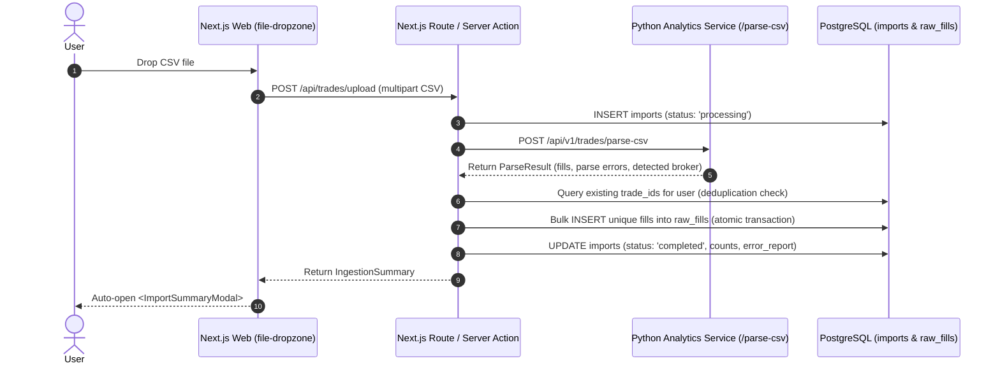

# Spec: Task 6 - Ingestion Validation Report & Trade ID Deduplication

## Assumptions & Principles
1. **Deduplication Boundary**: Deduplication is strictly scoped to `(user_id, trade_id)` enforced by the database constraint `uq_raw_fills_user_trade`. Any incoming fill matching an existing `trade_id` for the authenticated `user_id` must be skipped and classified as `DUPLICATE_FILL` in the import audit report without causing the entire batch to fail.
2. **Partial Batch Resilience**: A tradebook CSV often contains overlapping date ranges with previously uploaded files. The ingestion pipeline must insert all valid new fills, isolate duplicates and malformed rows into `error_report`, and set the import status to `completed` if processed (even if 0 new fills were added due to 100% duplicate coverage).
3. **Intra-File Duplicate Collisions**: A single CSV file may contain repeated entries with the same `trade_id`. The validator maintains an in-batch tracking set (`seen_in_batch`) so that only the first occurrence is ingested and subsequent occurrences are flagged as `DUPLICATE_FILL`, preventing database constraint violations during bulk insertion.
4. **100% Duplicate Status Resolution**: If all rows in a file are pre-existing duplicates, the import status is marked `completed` with a prominent informational banner (`"All trade records in this file already exist in your journal. 0 new fills imported."`). It is NOT marked `failed`, ensuring the user knows their file was parsed and processed successfully. `status = "failed"` is reserved exclusively for unparseable files, header mismatches, or 100% corrupt rows.
5. **Testability Without Live DB Dependency**: The Python ingestion service (`IngestionValidator`) supports dependency injection (`existing_trade_ids_fetcher` and `fill_committer` callables) so unit tests in `test_ingestion_validator.py` execute instantaneously in-memory without requiring a running PostgreSQL instance, while also supporting production database connections.
6. **Auditable Cascade Deletion**: Deleting an import run via `deleteImport(importId)` cascades in PostgreSQL to remove all linked `raw_fills` and removes the file from private Supabase Storage (`trade-imports/<user_id>/<import_id>.csv`).
7. **High-Performance Multi-Row Inserts**: Bulk insertion of fills utilizes parameterized multi-row `INSERT INTO raw_fills (...) VALUES (...)` inside an atomic transaction to ensure processing thousands of fills completes in <1s.
8. **Interactive UI Summary Modal**: After a CSV is uploaded and processed, the UI automatically displays an Import Summary modal detailing total rows, newly imported fills, skipped duplicates, and an expandable list of line-by-line warnings/errors. Users can also re-open the modal at any time from the Import History table.

---

## Objective
Build the end-to-end ingestion validation and deduplication service in Python and Next.js that:
- Commits parsed fills (`RawFillCreate`) from Task 5 into PostgreSQL `public.raw_fills`.
- Prevents double-counting by detecting and skipping duplicate trade IDs / deterministic fill hashes (both database duplicates and in-file duplicates).
- Updates the `imports` record with finalized metrics (`total_rows`, `imported_rows`, `skipped_rows`) and a structured `error_report` JSON payload.
- Exposes an interactive, accessible Import Summary modal in Next.js showing row statistics, status badges, and expandable line-by-line issue details.
- Provides interactive deletion of individual import runs with confirmation dialog and automatic cascade cleanup.

---

## Architecture & Data Flow



---

## Tech Stack
- **Backend Service**: FastAPI, Python 3.11+, Pydantic v2, `psycopg` (with PostgreSQL connection pool) / Supabase REST client
- **Frontend UI**: Next.js 14+ (App Router, Server Actions, React 18, Tailwind CSS, Lucide icons, Framer Motion)
- **Database & Storage**: PostgreSQL 16 with Row-Level Security (RLS), Supabase Storage
- **Testing**: `pytest` 8+, `pytest-asyncio`, `vitest`

---

## Commands

### Backend Verification (Python)
```powershell
# Run ingestion validator unit tests (fast, in-memory)
.\services\analytics\.venv\Scripts\pytest services/analytics/tests/test_ingestion_validator.py -v

# Run full analytics test suite
.\services\analytics\.venv\Scripts\pytest services/analytics/tests/test_health.py services/analytics/tests/test_upload.py services/analytics/tests/test_parsers.py services/analytics/tests/test_ingestion_validator.py -v

# Type checking
.\services\analytics\.venv\Scripts\mypy services/analytics/app/ingestion services/analytics/app/models
```

### Frontend Verification (Next.js)
```powershell
# Run frontend test suite
npm test --prefix apps/web

# Build check
npm run build --prefix apps/web
```

---

## Project Structure

```
services/analytics/app/
├── ingestion/
│   ├── __init__.py                → Package exports: IngestionValidator, DeduplicationResult
│   └── validator.py               → IngestionValidator service (deduplication, batch commit, metrics)
├── models/
│   ├── fills.py                   → RawFillCreate, ParseResult models (from Task 5)
│   └── ingestion.py               → IngestionSummary, RowIssue models
└── routers/
    └── upload.py                  → POST /api/v1/trades/validate-and-import endpoint (optional orchestration)

apps/web/
├── app/(dashboard)/imports/
│   └── page.tsx                   → Imports history table, dropzone, and modal integrations
├── components/trades/
│   ├── file-dropzone.tsx          → Dropzone calling ingestion action and opening summary modal
│   ├── import-summary-modal.tsx   → Accessible dialog showing row metrics and expandable issue accordion
│   └── delete-import-dialog.tsx   → Confirmation modal for cascading import deletion
└── lib/trades/
    ├── actions.ts                 → Server actions: processImportBatch, deleteImport, getRecentImports
    └── types.ts                   → IngestionSummary, RowIssue frontend interfaces

tests/
├── services/analytics/tests/
│   └── test_ingestion_validator.py → Pytest suite for deduplication, conflict handling, and error logging
└── apps/web/tests/
    └── import-modal.test.ts        → Vitest suite for summary modal calculations and error filtering
```

---

## Code Style & Data Contracts

### 1. Ingestion Audit Contract (`RowIssue` and `IngestionSummary`)
```python
from __future__ import annotations
from typing import Any, Literal, Optional
from uuid import UUID
from pydantic import BaseModel, Field

class RowIssue(BaseModel):
    row_index: Optional[int] = Field(None, description="Original CSV line number")
    issue_type: Literal["DUPLICATE_FILL", "INVALID_FORMAT", "CORRUPT_DATA", "SCHEMA_MISMATCH"]
    message: str = Field(..., description="Human-readable explanation")
    trade_id: Optional[str] = Field(None, description="Trade ID if identified")
    raw_snippet: Optional[dict[str, Any]] = None

class IngestionSummary(BaseModel):
    import_id: UUID
    user_id: UUID
    broker: str
    file_name: str
    status: Literal["completed", "failed"]
    total_rows: int
    imported_rows: int
    skipped_rows: int
    error_report: list[RowIssue]
```

### 2. Python Ingestion Validator Service (`validator.py`)
```python
class IngestionValidator:
    """Validates and deduplicates trade fills before database commitment."""

    def __init__(self, existing_trade_ids_fetcher=None, fill_committer=None):
        self._fetch_existing = existing_trade_ids_fetcher
        self._commit_fills = fill_committer

    def process(
        self,
        user_id: UUID,
        import_id: UUID,
        broker: str,
        file_name: str,
        fills: list[RawFillCreate],
        parse_errors: list[dict[str, Any]],
    ) -> IngestionSummary:
        """Filter out duplicate trade IDs and collect row-by-row audit issues."""
        existing_ids = set()
        if self._fetch_existing:
            all_trade_ids = [f.trade_id for f in fills if f.trade_id]
            existing_ids = set(self._fetch_existing(user_id, all_trade_ids))

        unique_fills: list[RawFillCreate] = []
        issues: list[RowIssue] = []

        # 1. Map parsing errors into standardized RowIssues
        for err in parse_errors:
            issues.append(RowIssue(
                row_index=err.get("row_index"),
                issue_type="CORRUPT_DATA" if "corrupt" in str(err).lower() else "INVALID_FORMAT",
                message=err.get("error", "Failed to parse trade row"),
                raw_snippet=err.get("raw_row"),
            ))

        # 2. Deduplicate fills against existing trade IDs and within-batch duplicates
        seen_in_batch = set()
        for idx, fill in enumerate(fills, start=1):
            if fill.trade_id in existing_ids:
                issues.append(RowIssue(
                    row_index=idx,
                    issue_type="DUPLICATE_FILL",
                    message=f"Fill with trade_id '{fill.trade_id}' already exists in your journal. Skipped.",
                    trade_id=fill.trade_id,
                ))
            elif fill.trade_id in seen_in_batch:
                issues.append(RowIssue(
                    row_index=idx,
                    issue_type="DUPLICATE_FILL",
                    message=f"Duplicate trade_id '{fill.trade_id}' found multiple times in the same CSV file. Skipped.",
                    trade_id=fill.trade_id,
                ))
            else:
                seen_in_batch.add(fill.trade_id)
                unique_fills.append(fill)

        # 3. Commit unique fills if committer provided
        if self._commit_fills and unique_fills:
            self._commit_fills(import_id, user_id, unique_fills)

        total_rows = len(fills) + len(parse_errors)
        imported_rows = len(unique_fills)
        skipped_rows = total_rows - imported_rows

        # Status is 'completed' if file processed cleanly (even if 0 new fills due to 100% duplicates).
        # Status is 'failed' only when 0 fills were imported and total_rows == len(parse_errors) (unparseable).
        status: Literal["completed", "failed"] = (
            "completed" if (imported_rows > 0 or (len(fills) > 0 and len(parse_errors) == 0)) else "failed"
        )

        return IngestionSummary(
            import_id=import_id,
            user_id=user_id,
            broker=broker,
            file_name=file_name,
            status=status,
            total_rows=total_rows,
            imported_rows=imported_rows,
            skipped_rows=skipped_rows,
            error_report=issues,
        )
```

### 3. Frontend Summary Modal Contract (`import-summary-modal.tsx`)
- Accessible dialog overlay (`role="dialog"`, `aria-modal="true"`).
- Metric grid:
  - **Total Evaluated Rows** (Neutral slate)
  - **Successfully Imported Fills** (Emerald green)
  - **Skipped / Duplicate Fills** (Amber warning)
- Expandable Issue Accordion:
  - Collapsible rows filtered by issue type badge (`DUPLICATE_FILL`, `INVALID_FORMAT`, etc.)
  - Clear line number indicator (`Row #24`) and human-readable explanation.
- Action Buttons:
  - "Done / View Dashboard" primary button.
  - "Upload Another File" secondary button.

---

## Testing Strategy

### Unit Tests (`test_ingestion_validator.py`)
1. **Identical Re-import Test**: Feed 5 fills where all 5 IDs already exist in the database -> `imported_rows == 0`, `skipped_rows == 5`, all 5 reported as `DUPLICATE_FILL`, status `completed`.
2. **Partial Overlap Test**: Feed 10 fills where 3 exist -> `imported_rows == 7`, `skipped_rows == 3`, status `completed`.
3. **In-File Duplicate Test**: Feed a file with duplicate rows within the same CSV -> only the first occurrence is imported, subsequent occurrences flagged as `DUPLICATE_FILL`.
4. **Corrupt Row Segregation**: Feed 3 valid fills and 2 malformed rows -> valid fills imported, malformed rows stored in `error_report`.
5. **Status Resolution**: Confirm status is `completed` when duplicates are skipped, and `failed` only when 0 valid rows exist with parsing errors.

### Frontend Component Tests (`import-modal.test.ts`)
1. Render modal with full success (0 errors) -> displays 100% green metrics without error accordion.
2. Render modal with mixed duplicates and format errors -> verify issue badge counts and accordion expansion.
3. Test keyboard escape and close button callbacks.

---

## Boundaries

### Always Do
- Enforce strict `user_id` scoping on every database query and deduplication lookup.
- Execute fill insertions within an atomic database transaction (`BEGIN ... COMMIT`).
- Store all skipped rows with specific reasons in `imports.error_report` for full user transparency.
- Provide accessible keyboard navigation (`Esc` to close) and focus trapping on modals.

### Ask First
- Modifying the underlying database schema or adding new columns to `raw_fills` or `imports`.
- Altering the cascade delete behavior on child tables.

### Never Do
- Never abort the entire import batch when encountering duplicate trade IDs (skip duplicates gracefully).
- Never double-insert fills with duplicate `(user_id, trade_id)` keys.
- Never expose raw database stack traces or SQL exceptions in the client-facing summary modal.

---

## Success Criteria
- [ ] Re-uploading the exact same tradebook CSV imports 0 new fills and marks all rows as `DUPLICATE_FILL` in the report with status `completed`.
- [ ] Uploading a CSV with 10 new trades and 2 duplicates results in exactly 10 rows inserted into `raw_fills` and 2 recorded in `error_report`.
- [ ] In-file duplicates with the same `trade_id` are caught and flagged without triggering database unique constraint violations.
- [ ] The Import Summary modal auto-opens upon CSV upload completion displaying row counts and expandable issue explanations.
- [ ] Clicking any historical import row in `/imports` allows re-opening its summary modal.
- [ ] Deleting an import run completely deletes the corresponding `raw_fills` records and removes the CSV file from storage.
- [ ] All Python and TypeScript unit tests pass without warnings or type errors (`pytest` and `vitest` green).
